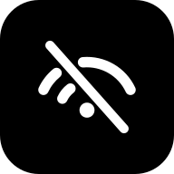

> [!IMPORTANT]
> **noTeleme3-code is an unofficial fork** of the [T3 Code source code](https://github.com/pingdotgg/t3code). It is not affiliated with, endorsed by, or maintained by T3 Tools, Inc. See [TRADEMARK.md](./TRADEMARK.md).
>
> This fork sends no product analytics, relay connection traces, or crash reports. See [docs/user/telemetry.md](./docs/user/telemetry.md) for what changed and what still talks to the network.

  

<h1 align="center">noTeleme3-code</h1>

A GUI for coding agents, without the telemetry.

noTeleme3-code runs the coding agents on your machine and gives them one interface. It works with Claude Code, Codex, Cursor, OpenCode, Grok Build, Antigravity, Kiro, Pi, Muse Code, fx, and any [ACP](./docs/user/providers-acp.md) agent.

It is the upstream app with its telemetry taken out and its branding replaced, and it follows upstream releases.

## Install

There are no published builds yet. Build from source with the [development runbook](./docs/operations/00_development.md#first-checkout), then run the desktop app or the `t3` server from your checkout.

Commands that install or update from the network (`t3 update`, `npx t3@latest`, and the install scripts in the docs) fetch upstream releases, which have telemetry on. Use your own build instead.

### Sign in to an agent

noTeleme3-code needs one agent that is installed and signed in. For example, install [Claude Code](https://claude.com/product/claude-code) and run `claude auth login`, or install [Codex CLI](https://developers.openai.com/codex/cli) and run `codex login`. [Provider setup](./docs/user/install.md#providers) has the steps for each agent.

## Documentation

- [Telemetry in this fork](./docs/user/telemetry.md)
- [Install and first run](./docs/user/install.md)
- [Remote access from another machine](./docs/user/remote-access.md)
- [Permission modes](./docs/user/permission-modes.md)
- [Source control](./docs/user/source-control.md)
- [Connect outside agents over MCP](./docs/user/outside-agents.md)

[All docs](./docs/README.md) has the full list.

## Rebranding after an upstream merge

`node scripts/fork-rebrand.ts` renames the upstream product name in shipped copy, points download, issue, and docs links at this repository, swaps the app icons' mark, and re-keys every translation catalog. Run it after each merge from upstream, then `vp run i18n:check`. A second run changes nothing.

A few changes are hand edits the script does not redo: this README, the install guide, the removed links to upstream's mobile store listings, the Expo account settings in `apps/mobile/app.config.ts`, and the raster icons. Resolve upstream changes to those files by hand.

## License

The source code is licensed under the [MIT License](./LICENSE). The license covers code only. T3 Code, T3 Connect, and the T3 logos are trademarks of T3 Tools, Inc. This fork does not use them as its own name or branding. See [TRADEMARK.md](./TRADEMARK.md).
